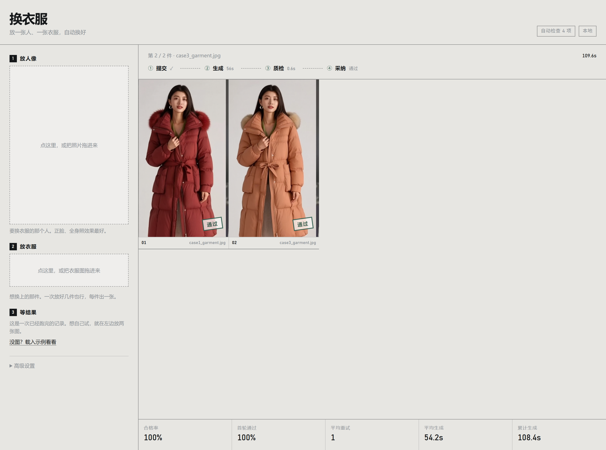
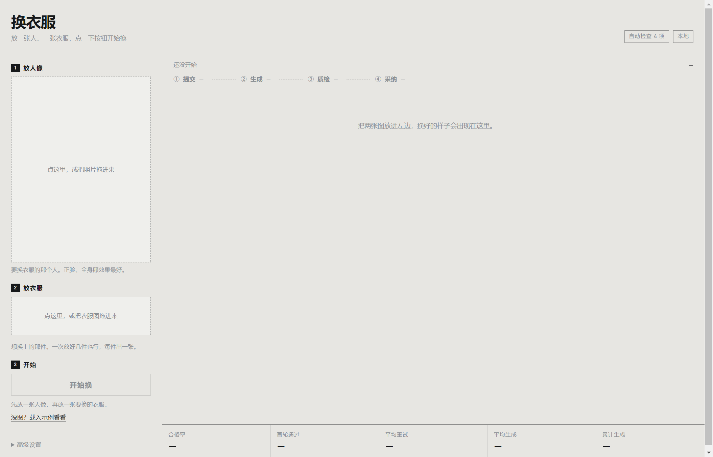

# 换装验收台

把「把一件衣服换到一个人身上」做成一条有验收标准的生产线，而不是点一次按钮看运气。

**用起来只有两步：放一张人像，放一件衣服。不用写指令，不用点按钮，放完自动开始。**

本地跑 Qwen-Image 2.1（INT8，16GB 显存），生成后自动做 4 项检查，不合格的图不是扔掉重来，而是把失败原因翻译成新的约束句再喂回去，最后从所有尝试里挑最好的一张。



---

## 它解决的问题

调用一次图像编辑接口很简单，难的是**知道自己这次出的图行不行**。

生成模型有随机性，同一组输入连跑三次会得到三张不同的图：一张完美，一张脸被换掉了，一张把参考图里的手机和店铺背景一起搬了过来。人眼看得出来，但没人愿意一百张一百张地看。

所以这个工具的重心不在"生成"，在"验收"和"返工"：

```
一张人像 + 多张服装
      │
      ├─ ① 提交 ──► ⓪ 整理参考图（裁掉人脸/手机/背景/水印）
      │                    │
      │                    ▼
      │              ② 生成（本地 ComfyUI，约 55s/张）
      │                    │
      │                    ▼
      │              ③ 质检：4 项自动判定
      │                    │
      │        ┌───────────┴───────────┐
      │     全部通过                 关键项不过
      │        │                        │
      │        ▼                        ▼
      └─ ④ 采纳（盖"通过"章）    失败项 ──► 翻译成追加约束
                                       │
                                       └──► 回到 ② 重试（最多 2 次）
                         最后：从所有尝试里挑分数最高的一张
```

每张图的每一次尝试都会落一行 JSONL：模型、完整提示词、耗时、seed、每一项检查的结果和分数。批次结束出汇总指标。

---

## 四个设计决策

### 1. 质检只列能判的四项

| 检查项 | 怎么判 | 关键项 |
|---|---|---|
| 脸没变 | 人脸检测 + 特征比对，余弦相似度 ≥ 0.45 | 是 |
| 衣服换上了 | 身体区域像素变化 ≥ 20% | 是 |
| 背景没动 | 各自取背景主色，距离 ≤ 30 | 否 |
| 没有多余的人 | 结果里的人脸数 ≤ 原图 | 否 |

手部结构、文字水印**判不了就不列**。列进去必然是一排"—"，看起来像坏了，实际上什么都没说。页面和 README 都写明这两项需要人看一眼。

### 2. 从所有尝试里挑最好的一张，不是"通过了就用最后一张"

这条是被实测逼出来的。原来只要通过就停，最后一次尝试决定结果。实际情况是：

> 第 2 次：护士的脸保住了，但背景被判不合格 → 触发重试
> 第 3 次：脸被参考图里的手机挡住了 → 而当时的判定只看背景，于是放行

**返工循环把好图改成了坏图，然后自己给它盖了章。** 现在每次尝试都留着打分，最后按 `(是否通过, 分数)` 取最优，并记录选的是第几次。

### 3. 只有关键项不过才重试

背景这类非关键项不过就重试，容易把已经对的结果改坏。现在只有脸或衣服不过才重试，其余记一笔就停。

### 4. 后端抽象不假装两个后端一样

本地 ComfyUI 和云端 API 不是等价的东西：

| | 本地 ComfyUI | 云端 API |
|---|---|---|
| 调用形态 | 提交 → 轮询队列 → 取图 | 一次请求返回 |
| 延迟 | 55s 起，冷启动另加 30s | 几秒到十几秒 |
| 成本 | 0 | 按张计费 |
| 失败模式 | 显存爆 / 节点报错 | 限流 / 余额 / 审核拒绝 |
| 重试代价 | 免费但慢 | 花钱 |

`GenResult` 里显式带 `cost`、`latency_s`、`error_kind`（vram / node_error / rate_limit / auth / network），上层按类型决定要不要重试，而不是一刀切。

---

## 实测数据

一张人像配一件衣服（1440×2560 的证件照 + 750×1000 的购物照，后者含人脸、手机、店铺背景、水印）：

| 指标 | 改之前 | 改之后 |
|---|---|---|
| 结果是否还是本人 | 不是（整幅照抄参考图） | 是，人脸相似度 0.74 |
| 参考图里的手机/水印 | 被搬进结果 | 没有 |
| 首轮通过 | — | 1/1 |
| 平均生成耗时 | 50.2s | 54.2s（多了裁图和人脸比对） |

人脸相似度的实测分布（阈值 0.45）：

| 样本 | 相似度 |
|---|---|
| 换对人的 | 0.75 / 0.86 / 0.88 / 0.88 / 0.90 |
| 换错人的 | −0.03 / 0.01 / 0.04 |
| 脸被手机挡住的 | 0.19 |

cfg 对比实验：cfg=1 与 cfg=4 视觉上几乎无差别，但 cfg=4 慢 22%（84.5s vs 69.3s）。所以默认 cfg=1。附带结论：cfg=1 时负向提示词在数学上不生效——看代码发现的，A/B 之后确认影响很小，因为关键约束都写在正向提示词里。

---

## 四个踩过的坑

**坑一：参考图干不干净，比提示词重要得多。**

同一张人像、同一句指令，只把参考图从「整张购物照（人脸 + 手机 + 店铺背景 + 水印）」裁成「只有衣服」，结果从"整幅照抄参考图"变成"人物保住、衣服换上"。

先试过改提示词，写了"不要取图2的人、脸、头发、手、手机、首饰、姿势、背景和光线"——没用，手机和水印照样出现在结果里。裁图才解决。

**坑二：像素比对判不了"是不是同一个人"。**

先后试了两种像素方法，都失败：
- 全局均值色差：棕色外套换暗红，均值只差 2.2，肉眼看天差地别；
- 头部区域相关：生成图常重新构图（近景/远景），对不齐就有假阴性；而整幅照抄的那张反而更像，产生假阳性。

最后走标准路径：人脸检测（YuNet）→ 对齐 → 特征（SFace）→ 余弦相似度。分离度立刻拉开。

**坑三：判定只看一部分，就会放行更差的结果。**

见上面第 2 条设计决策。这是整个项目里最值得讲的一个 bug：**质量门禁本身成了质量问题的来源**。

**坑四：自己的守卫把自己拦住了。**

第一次加裁图逻辑时写了个"裁掉面积太少就不折腾"的门槛，设成 0.6。那张 750×1000 的参考图裁完还剩 0.62，被拦掉，于是水印和手机全留着。门槛应该放在"几乎没裁"（0.85）上，不是"裁得不多"。

---

## 桌面应用

双击 `启动换装台.bat`，或者命令行 `npm start`。



首次运行前装一次依赖（Electron 的二进制在 GitHub 上，国内需要镜像）：

```bash
set ELECTRON_MIRROR=https://npmmirror.com/mirrors/electron/
npm install
```

它会自己按顺序做这几件事，你只需要等窗口出来：

1. 8188 没响应 → 按 `config.json` 里的 `desktop.comfyui_dir` 拉起 ComfyUI，最多等 120 秒
2. 8770 没响应 → 用 `desktop.python` 起 `run.py`，最多等 60 秒
3. 两个端口都就绪 → 开窗口加载页面
4. 关窗口 → 收掉它自己起的进程（不是它起的就不动）

两个刻意的选择：

- **userData 放在项目目录**（`.electron-data/`），不写 `%APPDATA%`，整个文件夹可以搬走
- **不重复起服务**：已经在跑的 8770/8188 不会被起第二个，也不会被误杀

配置项（`config.json`）：

```json
"desktop": {
  "python": "D:\\Comfyui\\python\\python.exe",
  "comfyui_dir": "D:\\Comfyui",
  "start_comfyui": true
}
```

`start_comfyui` 设 `false` 就只启 Web 服务，ComfyUI 你自己开。

冒烟检查（会截图到 `outputs/electron-window.png` 然后自动退出）：

```bash
npm run smoke
```

## 怎么跑（浏览器）

前置：ComfyUI 已启动（默认 8188），模型在 `config.json` 里指定，人脸模型在 `models/` 下。

```bash
# 只启 Web 服务（用 ComfyUI 自带的 python 即可，依赖 PIL / numpy / cv2，ComfyUI 环境里都有）
python run.py
# → http://127.0.0.1:8770
```

把两张图拖进去（或点两下选图），点「开始换」：

- 想一次换好几件：第 2 步可以一次放多张，每件出一张图
- 想改指令：页面底部「高级设置」里有一份默认指令，一般不用动
- 想直接看效果：点「没图？载入示例看看」，或者打开 `http://127.0.0.1:8770/?demo`
  （示例图不进版本库，见 `samples/README.md`）
- 看一次已经跑完的历史任务（结果从 JSONL 还原，服务重启也不失效）：

```
http://127.0.0.1:8770/?job=6e8f778cfcbb
```

命令行跑一批（不需要浏览器）：

```bash
python tools/run_batch.py \
  --person samples/case1_person.jpg \
  --garments samples/case1_garment.jpg samples/case3_garment.jpg
```

---

## 目录

```
app/
  graph.py            把一次请求翻译成 ComfyUI API 图（手写，不用 UI 导出的 JSON）
  pipeline.py         整理参考图 → 生成 → 质检 → 补约束 → 重试 → 挑最优
  prep.py             参考图裁剪（这层是效果的关键）
  store.py            JSONL 证据层 + 批次指标
  server.py           零依赖 HTTP 服务（stdlib，不引 FastAPI）
  adapters/
    base.py           GenRequest / GenResult，把成本·延迟·失败类型摊开
    comfyui.py        本地后端：提交、轮询、取图、失败分类
    cloud.py          云端后端：OpenAI images/edits 形态
  judge/
    base.py           4 项检查定义 + 失败项→约束的映射表
    faces.py          人脸检测与特征比对（YuNet + SFace）
    rules.py          逐项判定实现
electron/
  main.js             桌面外壳：起服务 → 开窗口 → 退出收尾
web/                  index.html / style.css / app.js，无框架
models/               face_detection_yunet.onnx / face_recognition_sface.onnx
tools/                smoke_test.py（单次验证）、run_batch.py（命令行批量）
runs/                 每次任务的 JSONL 检验单
启动换装台.bat        双击启动桌面应用
```

---

## 已知限制

- **手部结构、文字水印不自动检查。** 本地没有能判这两项的可信方法，所以不做，页面会提示"需人看一眼"。
- **背景检查只对纯色/简洁背景有效。** 背景太杂时取不到背景主色，这一项返回 null，不计入判定。
- **人像里必须有一张能检测到的脸**，否则"脸没变"这一项无法比对，退化为 3 项判定。
- **人脸相似度阈值是实测标定的**（好 0.75+，坏 0.00–0.19），换模型或换人群后需要重新标。
- **云端后端没有用真实 key 验证过。** 接口形状按 OpenAI `images/edits` 的 multipart 约定写的。
- **单机独占 GPU。** 服务没有队列调度，两个任务同时提交会排队等同一个 ComfyUI。

## 它不是什么

- 不是换脸工具。目标是服装迁移，不是把别人的脸贴上去。
- 不是批量抠图或修图。输入质量差（褶皱、水印、糊）出来就是废图，这是模型的下限。
- 不是产品。没有登录、没有计费、没有多租户，它是一次工程验证。
