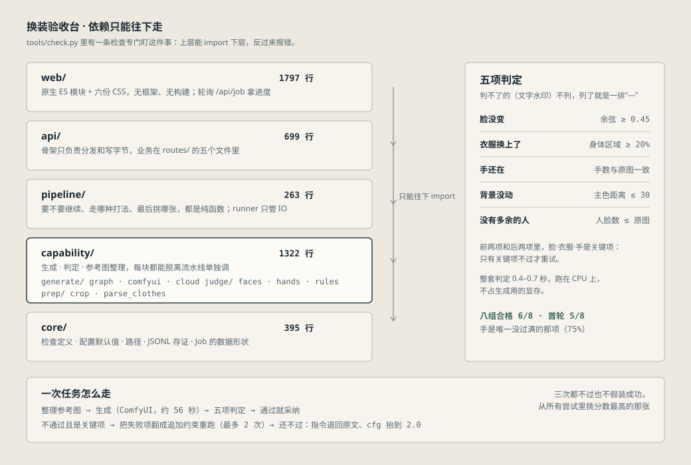

# 换装验收台 · Swap Bench

[](https://github.com/Light22332/swap-bench/actions/workflows/check.yml)

给一张人像和一件衣服，把衣服换到人身上；换完之后**自己验收**，不合格的自动返工，最后从所有尝试里挑最好的那张。全部跑在本地。

> **Swap Bench** is a local garment-swap pipeline that checks its own output.
> You drop one person photo and one garment photo; it generates the swap with Qwen-Image 2.1
> in ComfyUI, then verifies the result with face recognition (YuNet + SFace), hand detection
> (MediaPipe palm detector + 21 landmarks, run through OpenCV DNN) and structural checks,
> retries only when the person, the clothing or the hands are wrong, and keeps the best attempt.
> Runs on a 16 GB laptop GPU, ~55 s per image, no cloud API.

**核心不是"能生成"，是"怎么知道自己出的图行不行"。**

- **用起来**：放两张图，点一下，等 55 秒
- **中途能停**：点了「停下」，正在生成的那张会跑完，之后不再重试
- **排队**：本地一次只跑一单，后提交的会排队（页面会写「排队中」）；云端不排队，直接并发
- **质检**：5 项真判定——人脸相似度、身体区域变化、手部数量、背景主色、人脸数量
- **不装的**：手指粘连、文字水印判不了就不列；手这一项只数得清"在不在"
- **看与取**：结果格上按住看原片，右上角「存档」翻以前的单子，工序条右侧一次打包下载
- **证据**：每次尝试一行 JSONL，批次给出合格率、重试次数、失败原因分布
- **跑在哪**：本地 16GB 显存，零云成本；云端后端接口也留了
- **换地址**：右上角「设置」里改本地/云端地址、密钥、模型名，保存即生效，不用重启


---

## 它解决的问题

调用一次图像编辑接口很简单，难的是**知道自己这次出的图行不行**。

生成模型有随机性，同一组输入连跑三次会得到三张不同的图：一张完美，一张脸被换掉了，一张把参考图里的手机和店铺背景一起搬了过来。人眼看得出来，但没人愿意一百张一百张地看。

所以这个工具的重心不在"生成"，在"验收"和"返工"：

```
一张人像 + 多张服装
      │
      ├─ ① 提交 ──► ⓪ 整理参考图（人像解析找出衣服，再决定怎么裁）
      │                    │
      │                    ▼
      │              ② 生成（本地 ComfyUI，约 55s/张）
      │                    │
      │                    ▼
      │              ③ 质检：5 项自动判定
      │                    │
      │        ┌───────────┴───────────┐
      │     全部通过                 关键项不过
      │        │                        │
      │        ▼                        ▼
      └─ ④ 采纳（盖"通过"章）    失败项 ──► 翻译成追加约束
                                       │
                                       └──► 回到 ② 重试（最多 2 次）
                                            还不过 → 降级重跑：指令退回原文 + cfg 抬到 2.0
                         最后：从所有尝试里挑分数最高的一张
```

每张图的每一次尝试都会落一行 JSONL：模型、完整提示词、耗时、seed、每一项检查的结果和分数。批次结束出汇总指标。

---

## 四个设计决策

### 1. 质检只列能判的五项

| 检查项 | 怎么判 | 关键项 |
|---|---|---|
| 脸没变 | 人脸检测 + 特征比对，余弦相似度 ≥ 0.45 | 是 |
| 衣服换上了 | 身体区域像素变化 ≥ 20% | 是 |
| 手还在 | 手掌检测 + 21 点关键点复核，手数与原图一致 | 是 |
| 背景没动 | 各自取背景主色，距离 ≤ 30 | 否 |
| 没有多余的人 | 结果里的人脸数 ≤ 原图 | 否 |

文字水印、手指粘连**判不了就不列**。列进去必然是一排"—"，看起来像坏了，实际上什么都没说。

手这一项能做的只是"数得清"：原图 2 只手、结果 1 只，报错。整只手糊成一团时复核置信度会掉下来，也能抓到（实测 0.52 那只）；但多一根手指、少一根这种局部错误判不出来。所以它叫「手还在」，不叫「手部结构合格」。同理，手套、插兜、手不在画面里的时候原图就检不出手，这一项直接返回 null，不算通过也不算失败。

### 2. 从所有尝试里挑最好的一张，不是"通过了就用最后一张"

这条是被实测逼出来的。原来只要通过就停，最后一次尝试决定结果。实际情况是：

> 第 2 次：护士的脸保住了，但背景被判不合格 → 触发重试
> 第 3 次：脸被参考图里的手机挡住了 → 而当时的判定只看背景，于是放行

**返工循环把好图改成了坏图，然后自己给它盖了章。** 现在每次尝试都留着打分，最后按 `(是否通过, 分数)` 取最优，并记录选的是第几次。

### 3. 只有关键项不过才重试，两轮还不过就降级

背景这类非关键项不过就重试，容易把已经对的结果改坏。现在只有脸、衣服、手不过才重试，其余记一笔就停。

重试两轮还不过，第三轮换一种打法：**指令退回原文，cfg 从 1.0 抬到 2.0**。

- 退回原文，是因为攒了两轮的"本次必须修正"会互相打架——越修越像在跟模型吵架。
- 抬 cfg 有实际意义：cfg=1 时负向提示词在数学上不参与采样（见后面的对比实验），"不要改脸、不要多一个人"这几条等于没写；抬到 2.0 它们才真正生效。

降级那轮还不过就认了：记一笔 stop，从所有尝试里挑分数最高的那张，不假装成功。降级次数记在 JSONL 和指标里（页面上的"平均重试"会写成 `1.5（降级 1 次）`），可以查到它到底救没过。

代价是：最坏情况一轮跑三次，约 3 分钟。`config.json` 里 `escape_attempts` 设 0 就关掉。

### 4. 后端抽象不假装两个后端一样

本地 ComfyUI 和云端 API 不是等价的东西：

| | 本地 ComfyUI | 云端 API |
|---|---|---|
| 调用形态 | 提交 → 轮询队列 → 取图 | 一次请求返回 |
| 延迟 | 55s 起，冷启动另加 30s | 几秒到十几秒 |
| 成本 | 0 | 按张计费 |
| 失败模式 | 显存爆 / 节点报错 | 限流 / 余额 / 审核拒绝 |
| 重试代价 | 免费但慢 | 花钱 |

`GenResult` 里显式带 `cost`、`latency_s`、`error_kind`（vram / node_error / rate_limit / auth / network），上层按类型决定要不要重试，而不是一刀切。

---

## 实测数据

一张人像配一件衣服（1440×2560 的证件照 + 750×1000 的购物照，后者含人脸、手机、店铺背景、水印）：

| 指标 | 改之前 | 改之后 |
|---|---|---|
| 结果是否还是本人 | 不是（整幅照抄参考图） | 是，人脸相似度 0.74 |
| 参考图里的手机/水印 | 被搬进结果 | 没有 |
| 首轮通过 | — | 1/1 |
| 平均生成耗时 | 50.2s | 54.2s（多了裁图和人脸比对） |

人脸相似度的实测分布（阈值 0.45）：

| 样本 | 相似度 |
|---|---|
| 换对人的 | 0.75 / 0.86 / 0.88 / 0.88 / 0.90 |
| 换错人的 | −0.03 / 0.01 / 0.04 |
| 脸被手机挡住的 | 0.19 |

手部这一项的实测（两级：手掌 ≥ 0.30 → 关键点复核 ≥ 0.70）：

| 样本 | 原图手数 | 结果手数 | 复核置信度 | 判定 |
|---|---|---|---|---|
| 5 组真实结果 | 2 | 2 | 0.84–0.99 | 通过 |
| 1 组真实结果（一只手在画面里） | 1 | 1 | 0.93 | 通过 |
| 同一件衣服连跑两次 | 2 | 1 + 1 处形状不对 | 0.52 | 不过 |
| 手插兜的那一张 | 2 | 0（2 处像手的位置） | 0.04 | 不过，返工后第 2 次手回来了 |
| 把一只手涂掉（合成） | 2 | 1 | — | 不过 |
| 复制一只手贴上去（合成） | 2 | 3 | — | 不过 |

第三行是真跑出来的，不是构造的：模特右手从袖口伸出来时糊成一团，五指连成一片。
两次生成都是这样，复核 0.52，页面报「像手但形状不对」。另有一张边界样本 0.75——
那只手偏简化但还认得出手形，0.70 的门槛下判通过。阈值就是照这两头定的。

第四行说明返工确实有用：第一次两只手都插进兜里，复核只有 0.04，判「找不到手」，
返工把"双手必须完整保留"写进追加约束，第二次两只手都画回来了（0.99 / 0.95），
最后按分数选中第二次。

二级复核还有个作用：压一级的误报。手掌检测器在一件平铺的皮草外套上会报出 2–3 个"手"（最高 0.87 分，比真手的 0.70 还高）。加上复核后，其中一个样本的误报被全部滤掉，另一个还剩 1 个 0.99 分的漏网。所以这一项只在"人像 vs 结果"之间比手数，不拿服装图当输入。

5 项质检合计耗时 0.4–0.7 秒。

参考图裁剪的实测（人像解析找出衣服框，再和固定比例框比"会切掉多少衣服"）：

| 样本 | 衣服占比 | 固定框切掉的衣服 | 走哪条路 | 结果 |
|---|---|---|---|---|
| 购物照（人脸+手机+水印） | 48% | 2.3% | 固定比例框 | 和以前一样，水印带被切掉 |
| 两张外套拼在一起的商品图 | 55% | 31% | 按衣服框 | 从 290×570 变成 345×552，不再削掉袖子，脸也切掉了 |
| 贴边特写（衣服顶到画面四边） | 74% | 27% | 按衣服框 | 框约等于全图 → 不裁 |
| 平铺图（只有衣服没有人） | 73% | 22% | 按衣服框 | 不裁，原来会被削掉 16% 的领口 |

判定门槛：固定比例框切掉的衣服像素 ≤5% 时，说明这是标准商品图排版，用它；否则用衣服框。
解析一次 0.4–0.6 秒（CPU）。

八组固定输入的回归基线（`tools/regression.py`，2026-10-29，`reports/base.json`；输入在 `bench/`，不随仓库分发）：

| 指标 | 值 |
|---|---|
| 合格率 | 6/8 = 75% |
| 首轮通过 | 5/8 = 62.5% |
| 平均重试 | 1.62 次 |
| 平均耗时 | 100.6 秒 |
| 人脸相似度 | 0.776 – 0.892 |

按检查项看：脸、衣服、背景、没有多余的人**四项全过**，手 75%。两处失败都是同一件橘色羽绒服
（换模特也一样），三次尝试全卡在手部。失败集中在"袖口接手掌"这一处，不是随机波动。

降级重跑的实测（case3 那件羽绒服，把 `max_attempts` 临时设成 1，好让降级那轮一定跑到）：

| 轮次 | 模式 | cfg | 耗时 | 结果 |
|---|---|---|---|---|
| 1 | base | 1.0 | 56.2s | 判「手少了 1 只」 |
| 2 | escape | 2.0 | 90.7s | 两只手都回来了（复核 0.99 / 0.89），通过 |

降级那轮慢 61%。最坏情况一轮跑三次约 3 分钟，所以默认只给一次降级。

cfg 对比实验：cfg=1 与 cfg=4 视觉上几乎无差别，但 cfg=4 慢 22%（84.5s vs 69.3s）。所以默认 cfg=1。附带结论：cfg=1 时负向提示词在数学上不生效——看代码发现的，A/B 之后确认影响很小，因为关键约束都写在正向提示词里。

---

## 五个踩过的坑

**坑一：参考图干不干净，比提示词重要得多。**

同一张人像、同一句指令，只把参考图从「整张购物照（人脸 + 手机 + 店铺背景 + 水印）」裁成「只有衣服」，结果从"整幅照抄参考图"变成"人物保住、衣服换上"。

先试过改提示词，写了"不要取图2的人、脸、头发、手、手机、首饰、姿势、背景和光线"——没用，手机和水印照样出现在结果里。裁图才解决。

后来把"按固定比例裁"换成"先跑人像解析认出衣服在哪"，又学到一件事：**盲切的比例之所以一直好用，是因为购物照都按同一个版式排版**（人物居中、上下各留一条）。换成平铺图或贴边特写，同样的 16%/10% 直接削掉衣服。所以现在是先量一量再决定，而不是一律盲切。

**坑二：像素比对判不了"是不是同一个人"。**

先后试了两种像素方法，都失败：
- 全局均值色差：棕色外套换暗红，均值只差 2.2，肉眼看天差地别；
- 头部区域相关：生成图常重新构图（近景/远景），对不齐就有假阴性；而整幅照抄的那张反而更像，产生假阳性。

最后走标准路径：人脸检测（YuNet）→ 对齐 → 特征（SFace）→ 余弦相似度。分离度立刻拉开。

**坑三：判定只看一部分，就会放行更差的结果。**

见上面第 2 条设计决策。这是整个项目里最值得讲的一个 bug：**质量门禁本身成了质量问题的来源**。

**坑四：自己的守卫把自己拦住了。**

第一次加裁图逻辑时写了个"裁掉面积太少就不折腾"的门槛，设成 0.6。那张 750×1000 的参考图裁完还剩 0.62，被拦掉，于是水印和手机全留着。门槛应该放在"几乎没裁"（0.85）上，不是"裁得不多"。

**坑五：掐断正在跑的那一条，会把后面几次一起带坏。**

调试时用 `/interrupt` 掐了一个正在执行的 prompt，紧接着连跑三次同样的输入，全部判不过（手 2 次、衣服 1 次，平均 94 秒）——这套输入十分钟前刚拿过 1.0 分。重启 ComfyUI 之后同样的输入一次就过，56.2 秒。

命令图里有个 `QwenImage21Cache` 节点会缓存上一轮的状态，被掐断的那轮留下的东西会带进后面。要中止，重启 ComfyUI，别掐单条。

---

## 桌面应用

双击 `启动换装台.exe`（5 KB 的启动器，不弹黑窗口）。没有 exe 时用 `启动换装台.bat`，或命令行 `npm start`。


首次打开半分钟上下：它先把 ComfyUI 拉起来（实测 22-25 秒），再起本地服务（1-2 秒），然后才开窗口。

**演示之前先双击 `预热.bat`。** 它做三件事：把 ComfyUI 拉起来、跑一张暖机图把模型压进显存、打印一句「可以开始演示了」。总共约 80 秒，做完之后单张 56-58 秒。不预热也能用，只是第一张要多等一截（模型是懒加载的）。

ComfyUI 是预热脚本起的，之后双击 `启动换装台.exe` 会发现 8188 已经在跑、不重复起，关窗口也不会把它带走。

首次运行前装一次依赖（Electron 的二进制在 GitHub 上，国内需要镜像）：

```bash
set ELECTRON_MIRROR=https://npmmirror.com/mirrors/electron/
npm install
```

它会自己按顺序做这几件事，你只需要等窗口出来：

1. 8188 没响应 → 按 `config.json` 里的 `desktop.comfyui_dir` 拉起 ComfyUI，最多等 120 秒
   （带 `--disable-auto-launch`，不会弹出 ComfyUI 的网页）
2. 8770 没响应 → 用 `desktop.python` 起 `run.py`，最多等 60 秒
3. 两个端口都就绪 → 开窗口加载页面
4. 关窗口 → 收掉它自己起的进程（不是它起的就不动）

两个刻意的选择：

- **userData 放在项目目录**（`.electron-data/`），不写 `%APPDATA%`，整个文件夹可以搬走
- **不重复起服务**：已经在跑的 8770/8188 不会被起第二个，也不会被误杀

配置项（`config.json`）：

```json
"desktop": {
  "python": "D:\\Comfyui\\python\\python.exe",
  "comfyui_dir": "D:\\Comfyui",
  "start_comfyui": true
}
```

`start_comfyui` 设 `false` 就只启 Web 服务，ComfyUI 你自己开。

冒烟检查（会截图到 `outputs/electron-window.png` 然后自动退出）：

```bash
npm run smoke
```

## 怎么跑（浏览器）

前置：ComfyUI 已启动（默认 8188），扩散模型在 `config.json` 里指定，质检和裁剪的模型在 `models/` 下（照 `models/README.md` 下载，约 157MB）。

```bash
# 只启 Web 服务：用 ComfyUI 自带的 python，需要的库（PIL / numpy / cv2 / torch / transformers）那个环境里都有
python run.py
# → http://127.0.0.1:8770
```

把两张图拖进去（或点两下选图），点「开始换」：

- 想一次换好几件：第 2 步可以一次放多张，每件出一张图
- 想直接看效果：点「没图？载入示例看看」，或者打开 `http://127.0.0.1:8770/?demo`
  （八张示例图随仓库带，都是本地模型生成的，见 `samples/README.md`。两个入口都只把图放好，
  不会自己开跑，还是要你点一下「开始换」）
- 看一次已经跑完的历史任务（结果从 JSONL 还原，服务重启也不失效）：

```
http://127.0.0.1:8770/?job=6e8f778cfcbb
```

命令行跑一批（不需要浏览器）：

```bash
python tools/run_batch.py \
  --person samples/demo_person_a.jpg \
  --garments samples/demo_garment_1.jpg samples/demo_garment_2.jpg
```

---

## 一次演示要多久

2026-10-30 在本机（RTX 5080 Laptop 16GB）量的：

| 步骤 | 实测 |
|---|---|
| `预热.bat`：ComfyUI 起来 | 22-25 秒 |
| `预热.bat`：暖机图（含加载模型） | 57-58 秒 |
| 一件衣服全程（生成 + 质检 + 落盘） | 57 秒（生成 56.2、质检 0.8） |
| 两件衣服 | 约 2 分钟 |

有一个会让数字翻倍的情况：**连点两次「开始换」**。以前两单同时进来，ComfyUI 一次只执行一张，
两单的图在它的队列里交替，各自的等待都被算进自己耗时（实测单张 56 秒变 150 秒）。
现在本地是一队 FIFO：第二单显示「排队中」，等第一单整单跑完才开始，单张仍是 56 秒上下。
云端后端不走这个队列——那边慢的是对方，排队只会更慢。

## 密钥放在哪

「设置」里填的云端密钥不写进 `config.json`——那个文件在版本库里。它单独落在 `config.local.json`，
这个文件被 `.gitignore` 挡着，`config.py` 读配置时会把它叠在 `config.json` 上面。

四道闸，任何一道单独生效都够：

1. **页面拿不到已存的密钥。** `GET /api/settings` 一律返回空串，只多给一个 `_api_key_set` 说是"有没有存"。
   所以密钥不会出现在截图、日志、接口基线文件里；留空保存等于"不改"，不会把已存的抹掉。
2. **`.gitignore`** 挡住 `config.local.json`、`*.local.json`、`.env*`、`*.pem`、`*.key`。
3. **提交前钩子。** 暂存内容里出现 `sk-…` 这类串，或者往里加 `config.local.json`，直接拒绝提交。
   装法：`python tools/install_hooks.py`（每个 clone 跑一次，钩子只在本地）。
4. **推送前再扫一遍。** 就算用 `--no-verify` 绕过了第 3 道，提交后的钩子会把这次提交再扫一次，
   扫到密钥只提交不推送，并提示你去看 `git show --stat HEAD`。

2026-10-30 查过一遍：仓库历史和索引里没有任何非空的 `api_key`，也没有 `config.local.json`。

---

## 代码怎么切的



四个包 `core ← capability ← pipeline ← api`，只能往下 import，反了 `tools/check.py` 会报错。
判定实现在 `capability/judge/`（`faces` / `hands` / `rules`），要不要继续、走哪种打法在
`pipeline/`（纯函数，单测覆盖），HTTP 层只负责分发和写字节。

---

## 目录

```
app/
  core/               契约层：检查定义、配置默认值、路径、JSONL 证据层、Job
    checks.py         5 项检查的定义与加权
    config.py         config.json 读取 + 默认值（唯一来源）
    paths.py          项目内路径
    store.py          JSONL 读写与批次指标
    models.py         Job / Case 的数据形状
  capability/         能力层：每个模块都能脱离流水线单独调用
    generate/
      graph.py        把一次请求翻译成 ComfyUI API 图（手写，不用 UI 导出的 JSON）
      comfyui.py      本地后端：提交、轮询、取图、失败分类
      cloud.py        云端后端：OpenAI images/edits 形态（未用真实 key 验证）
    judge/
      faces.py        人脸检测与特征比对（YuNet + SFace）
      hands.py        手掌检测 + 21 点关键点（MediaPipe 模型，走 OpenCV DNN）
      rules.py        逐项判定实现
    prep/
      crop.py         参考图裁剪：先量再决定按衣服框裁还是按比例裁
      parse_clothes.py 人像解析：SegFormer-B2 找出身上的衣服在哪
  pipeline/           编排层
    policy.py         要不要继续、用什么打法（纯函数）
    select.py         最后挑哪张（纯函数）
    runner.py         串起来跑，负责 IO 和记账
  api/                HTTP 层
    server.py         骨架：分发与写字节
    routes/           config / jobs / run / upload / static
    state.py          配置快照与在跑的任务表
    history.py        从 JSONL 还原、存档列表、打包导出
electron/
  main.js             桌面外壳：起服务 → 开窗口 → 退出收尾
web/                  index.html + css/ 六个文件 + js/ 六个原生 ES 模块，无框架、无构建
models/               人脸两个 onnx + 手部两个 onnx + segformer_b2_clothes/（都不进版本库）
samples/              八张示例图，随仓库分发（本地模型生成）
bench/                回归用的八组固定输入（不进版本库，见 bench/README.md）
tools/                check.py（一键检查）、replay.py（历史回放）、api_baseline.py（接口形状对比）、warmup.py（预热）、run_batch.py（命令行批量）
runs/                 每次任务的 JSONL 检验单
启动换装台.exe        双击启动（无黑窗口）
启动换装台.bat        同一件事的 bat 版，exe 不能用时兜底
预热.bat              演示前跑一次：拉起 ComfyUI 并暖机，之后单张快一截
```

---

## 已知限制

- **手只数得清"在不在"。** 手指粘连、指节畸形这类结构问题看不出来。手被身体挡住、戴手套、手不在画面里时，原图就检不出手，这一项返回 null，不算通过也不算失败。
- **参考图裁剪只能切矩形。** 人脸、手、水印都散在衣服四周时，矩形框裁不干净；衣服贴着画面四边时（贴边特写），框约等于全图，等于没裁。要更干净得做抠图（把非衣服像素涂掉），不是现在的做法。
- **人像解析模型只许非商业使用**（NVIDIA Source Code License）。自己用和放作品集没问题，商用要换 rembg 的 `u2net_cloth_seg`（MIT），换的是 `app/capability/prep/parse_clothes.py` 里的推理后端。
- **文字水印不自动检查。** 本地没有能判这项的可信方法，页面会提示"需人看一眼"。
- **背景检查只对纯色/简洁背景有效。** 背景太杂时取不到背景主色，这一项返回 null，不计入判定。
- **人像里必须有一张能检测到的脸**，否则"脸没变"这一项无法比对，退化为 3 项判定。
- **人脸相似度阈值是实测标定的**（好 0.75+，坏 0.00–0.19），换模型或换人群后需要重新标。
- **云端后端没有用真实 key 验证过。** 接口形状按 OpenAI `images/edits` 的约定写，客户端逻辑（b64_json / url / data URL / 401 / 429 / 未配置）在 `tools/tests/test_cloud.py` 里用本地假服务器覆盖了；真正花钱跑通还没做过。地址、密钥、模型名在右上角「设置」里填，切后端也在那里。
- **单机独占 GPU。** 本地后端是一队 FIFO，一次只跑一单；后提交的在页面上显示「排队中」。云端后端不排队，直接并发。

## 它不是什么

- 不是换脸工具。目标是服装迁移，不是把别人的脸贴上去。
- 不是批量抠图或修图。输入质量差（褶皱、水印、糊）出来就是废图，这是模型的下限。
- 不是产品。没有登录、没有计费、没有多租户，它是一次工程验证。
